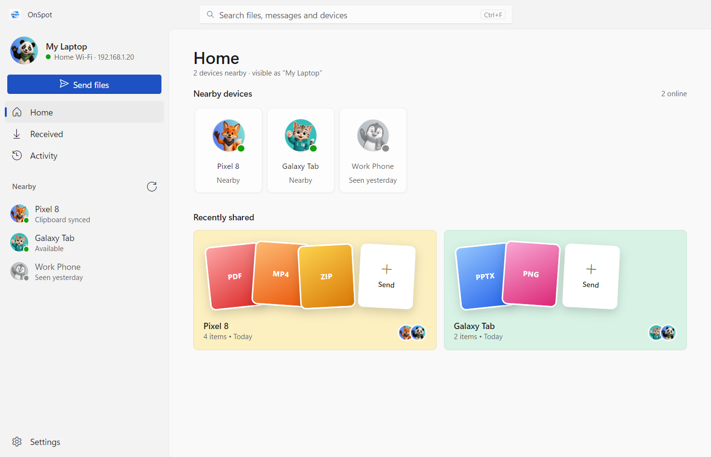
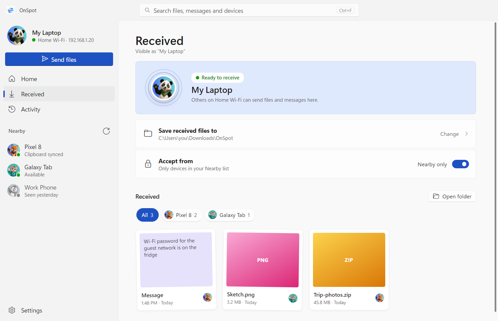
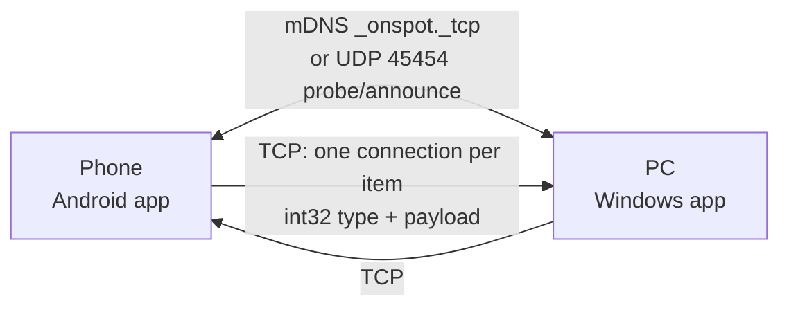

<div align="center">


**Send files, text and your clipboard between your phone and your PC. Over your own Wi‑Fi, with no cloud and no cables.**

[](LICENSE)




</div>

---

OnSpot is a small, fast way to move things between the devices on your desk. Open it on your phone and on your laptop, and they find each other on the local network. Then you can send photos, documents, folders, a quick note or your clipboard in a tap.

Nothing leaves your network. There's no account, no upload and no file size limit beyond your disk space.

## Download

| Platform | Download | Requirements |
|---|---|---|
| **Windows** | [**OnSpot-Setup.exe**](https://github.com/iboopathiraja/OnSpot-File-Sharing-Tool/releases/latest/download/OnSpot-Setup.exe) | Windows 10 or 11 (64-bit) |
| **Android** | [**OnSpot.apk**](https://github.com/iboopathiraja/OnSpot-File-Sharing-Tool/releases/latest/download/OnSpot.apk) | Android 7.0 or newer |

All versions and their changes are listed on the [Releases](https://github.com/iboopathiraja/OnSpot-File-Sharing-Tool/releases) page.

> **First install:** Windows may show *"Windows protected your PC"* because the installer isn't code-signed yet. Click **More info → Run anyway**. On Android, allow your browser or file manager to *install unknown apps* when asked.

## Features

- **Finds devices automatically** with mDNS (`_onspot._tcp`) plus a UDP fallback, so it still works on routers that block multicast.
- **Works on Wi‑Fi or a phone hotspot.** No router? Turn on the hotspot on one device and connect the other.
- **Send anything:** files of any size, whole folders, photos and videos, short text messages.
- **Clipboard sync** between two devices, after both sides agree (a request/approve handshake).
- **Live progress** with per‑device progress rings, cancel and retry, and a full activity history.
- **Safe receiving:** files land in `Downloads/OnSpot`, names never overwrite each other, there's an optional *"only from my devices"* filter, and the free‑space check happens before a transfer starts.
- **Profiles:** pick a name and an avatar, and the picture updates on other devices in real time.
- **Native feel on both sides:** Jetpack Compose on Android; Mica, light/dark and accent colour on Windows 11.

<div align="center">

</div>

## How it works



1. Each device advertises itself as `OnSpot_<name>` and listens for incoming TCP connections.
2. Every file, message or clipboard update is sent over its own short TCP connection: a 4‑byte type, then the payload (Java `DataOutputStream` framing).
3. Both apps speak exactly the same protocol, so any mix of phones and PCs can talk to each other.

The wire format is documented in [docs/PROTOCOL.md](docs/PROTOCOL.md) if you want to write your own client.

## Getting started

### Windows app

Requires Node.js 18+.

```bash
cd desktop
npm install
npm start          # run in development
npm test           # protocol and transfer tests
npm run dist       # build the installer into desktop/dist
```

When Windows asks, allow OnSpot through the firewall on **Private** networks. It needs this to be found and to receive files.

### Android app

Requires Android Studio (Ladybug or newer) and JDK 17.

1. Open the `android/` folder in Android Studio.
2. Let Gradle sync, then run the `app` configuration on a phone or emulator.

To build a signed release, set `KEYSTORE_PATH`, `STORE_PASSWORD` and `KEY_PASSWORD` in your environment. Debug builds need none of these.

## Project layout

```
.
├── android/                Android app (Kotlin, Jetpack Compose)
│   └── app/src/main/java/com/beyondzero/onspot/
│       ├── data/           discovery (NSD + UDP), transfers, settings, history
│       ├── presentation/   Compose screens: home, files, devices, onboarding, intro
│       └── service/        foreground service that keeps transfers alive
├── desktop/                Windows app (Electron)
│   ├── src/core/           protocol, discovery, transfer engine (plain Node, unit-tested)
│   ├── src/renderer/       UI (vanilla JS + CSS, no framework)
│   └── test/
└── docs/                   protocol spec and images
```

## Security

OnSpot is built for networks you trust, like your home Wi‑Fi or your own hotspot. Transfers are **not encrypted**, and devices are identified by IP address. Turn on *"Only accept from my devices"* if you share the network with others. Encrypted transfers with device pairing are on the roadmap.

## Roadmap

- [ ] Pairing with a short code, and encrypted transfers (TLS)
- [ ] macOS and Linux builds of the desktop app
- [ ] Resume interrupted transfers
- [ ] Share sheet target on Windows ("Send to → OnSpot")

## Contributing

Bug reports, ideas and pull requests are welcome. See [CONTRIBUTING.md](CONTRIBUTING.md) for how to get set up, and open an issue first for larger changes.

## License

[MIT](LICENSE) © BoopathiRaja Kannan
